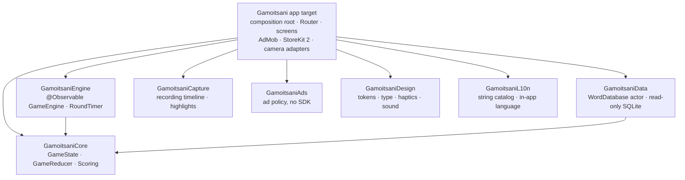
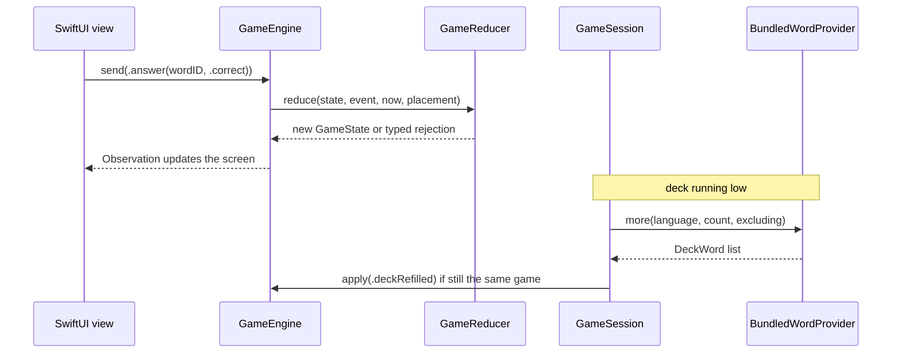

<p align="center">
  
</p>

# Gamoitsani

**A Georgian word-guessing party game for iPhone and iPad.** [Download on the App Store](https://apps.apple.com/ge/app/gamoitsani/id6502697351)

Gamoitsani is an Alias-style party game. Teams take turns, one player describes words
against the clock, and their team races to guess them. Classic mode shows one word at a
time; Arcade mode puts five on screen at once and lets a team swap the whole set for a
penalty. Super words are worth triple, every team can be dealt a silly speaking rule for
the game, and the front camera can record a turn and turn it into a highlight reel. The
App Store version has about **5,290 downloads**. Version 2.0 is a ground-up SwiftUI
rewrite built around a curated **~20,000-word** database that ships inside the app and
works fully offline.

## Screenshots

| Setup | Classic | Arcade | Podium |
|:---:|:---:|:---:|:---:|
| [SCREENSHOT: gamoitsani-setup] | [SCREENSHOT: gamoitsani-play-classic] | [SCREENSHOT: gamoitsani-play-arcade] | [SCREENSHOT: gamoitsani-podium] |

## Architecture

The app target is a thin SwiftUI composition root over eight local Swift packages in
`Libraries/Packages/`. The domain package at the bottom imports nothing but Foundation,
and no package depends on one above it. Seven packages are linked into the app.
`GamoitsaniMacros` (a `@UserDefault` macro) is a standalone package with its own tests.



**The game loop is a pure reducer.** Screens send a `GameEvent` to a `@MainActor
@Observable` `GameEngine`. The engine calls `GameReducer.reduce` with the current state,
the event, the current time and any randomness it needs. The result is either a new
`GameState` or a typed `GameEventRejection`. Results of async work come back through a
separate `GameEffect` channel that screens can't reach.



| Package | What it owns |
|---|---|
| `GamoitsaniCore` | `GameState`, `GameEvent` / `GameEffect`, `GameReducer`, `Scoring`, `GameRules`, `Team`, `Deck`, `Challenge`, `TeamDraw`, `Awards` |
| `GamoitsaniEngine` | `GameEngine` (injected clock and randomness), deadline-based `RoundTimer` |
| `GamoitsaniData` | `WordDatabase` actor over the SQLite3 C API, `BundledWordProvider`, `SeenWords` |
| `GamoitsaniCapture` | What a recording contains and which moments make the highlight reel. No AVFoundation. |
| `GamoitsaniAds` | When an ad may show: consent, purchase, cadence, never mid-round. No ad SDK. |
| `GamoitsaniDesign` | Light/dark tokens, typography, `haptics` modifier, synthesised sounds, Mersad font |
| `GamoitsaniL10n` | String catalog and lookup in the language chosen in the app, not the device's |
| `GamoitsaniMacros` | `@UserDefault` accessor macro (swift-syntax) |

### Decisions worth knowing about

- **Time is a deadline.** A round stores when it ends; remaining time is derived from it.
  Backgrounding the app can't pause the clock, and a saved game resumes with the exact
  time it had left.
- **Words ship in the app.** Each language is one read-only `words_<lang>.db` file in
  `GamoitsaniData/WordFiles`, queried with parameterised SQL. Adding a language means
  adding a file, because the language picker is built from the files present. Words a
  group has already played are excluded from later games.
- **Saves survive updates.** `GameState`, `GameSettings` and `Team` decode by hand, so a
  game saved before a new field existed still loads.
- **Late async results are dropped.** `GameSession` stamps each game with a generation,
  so a deck top-up that returns after the player started a new game is discarded.
- **SDKs stay at the edge.** Feature code talks to `AdServing`, `Purchasing` and
  `TurnRecording` protocols. AdMob, StoreKit 2 and AVFoundation live only in the app
  target's adapters.

## Tech stack

- **Language:** Swift 6 with strict concurrency in every package.
- **UI:** SwiftUI, Observation, `NavigationStack` with a typed `Route` enum. UIKit only
  in the camera and export code and in two small representables.
- **Data:** bundled SQLite (raw SQLite3, no wrapper library); `Codable` JSON for the
  game in progress and the seen-word list.
- **Platform:** StoreKit 2 (remove-ads purchase), AVFoundation and Photos (turn
  recording), UserNotifications (weekly reminder), `ShareLink` (results card).
- **Ads:** Google Mobile Ads with UMP consent and App Tracking Transparency; Liftoff
  (Vungle) and Meta mediation.
- **Dependencies:** Swift Package Manager for local packages. CocoaPods only for the ad
  SDKs.
- **Testing:** Swift Testing and XCTest suites inside each package. Design-token tests
  assert WCAG contrast in light and dark mode.
- **CI:** GitHub Actions on macOS:
  - builds the app;
  - runs every package's tests;
  - verifies localization keys and the built app's ad configuration;
  - runs Thread and Address Sanitizer weekly.
- **Requirements:** iOS 18+, iPhone and iPad.
- **Languages:** word decks in 11 languages. The UI is in Georgian and English, and
  partly translated into nine more.

## How to build

Requirements: Xcode 16 or newer, CocoaPods 1.16+. Full details and troubleshooting are in
[`docs/SETUP.md`](docs/SETUP.md).

```bash
git clone https://github.com/davita00101110dmg/Gamoitsani.git
```

```bash
cd Gamoitsani
```

The template ships Google's public test ad units, so the app builds and runs as is:

```bash
cp Gamoitsani/Config.xcconfig.template Gamoitsani/Config.xcconfig
```

```bash
LANG=en_US.UTF-8 pod install
```

Always open the workspace, not the `.xcodeproj`:

```bash
open Gamoitsani.xcworkspace
```

Tests live in the packages, not the app target. Each package runs on its own:

```bash
cd Libraries/Packages/GamoitsaniCore && xcodebuild test -scheme GamoitsaniCore -destination 'platform=iOS Simulator,name=iPhone 17'
```

The macro package is a compiler plugin and runs on the host:

```bash
cd Libraries/Packages/GamoitsaniMacros && swift test
```

## What's next

- **Release 2.0** to replace the 1.x build on the App Store. Then retire the Firestore
  rules and config that remain only for 1.x.
- **Taboo mode.** The word database already has a `taboo_terms` table, waiting for
  content.
- **Charades mode.** The Georgian database already flags which words can be acted out.
- **Rewarded ads.** They're implemented and covered by the ad policy. The missing piece
  is something worth trading an ad for, such as extra words when a deck runs out.
- **Translations.** Finish the UI strings for the nine partly translated languages,
  and get the exported word lists reviewed by native speakers.

## Credits & contact

- Font: [Mersad](https://www.behance.net/gallery/145150505/Mersad-Free-Variable-Typeface)
  variable typeface.
- Built by Daviti Khvedelidze:
  [LinkedIn](https://www.linkedin.com/in/davitikhvedelidze/) ·
  [davitikhvedelidze26@gmail.com](mailto:davitikhvedelidze26@gmail.com).
- Licensed under the [MIT License](LICENSE).
